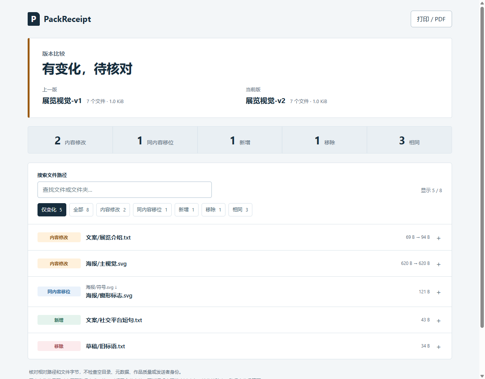

# PackReceipt

Check what changed in a delivery folder, then verify what arrived.

PackReceipt reads ordinary folders and creates SHA-256 manifests. Compare two versions or check a received folder against the sender's receipt. The result is a self-contained HTML report with path search, status filters, expandable hashes and a print view. Nothing is uploaded; source files are read, never rewritten.

[中文说明](README.zh-CN.md) · [Download v0.1.0](https://github.com/aevumworks/packreceipt/releases/tag/v0.1.0)



## Use it

Requires **Python 3.10+**. No third-party packages, account, server or installation step. Download `packreceipt-0.1.0.pyz` from Releases. On Windows, use `py` instead of `python` if that is your Python launcher.

```sh
# Sender: save the receipt OUTSIDE the folder being scanned.
python packreceipt-0.1.0.pyz scan ./delivery --out ./delivery-receipt.json

# Recipient: check the received folder and open received.html.
python packreceipt-0.1.0.pyz verify ./delivery-receipt.json ./received --html ./received.html
```

For a revision, save a second receipt and compare the two:

```sh
python packreceipt-0.1.0.pyz scan ./delivery-v2 --out ./v2.json --label "Exhibition v2"
python packreceipt-0.1.0.pyz compare ./delivery-receipt.json ./v2.json --html ./changes.html --json ./changes.json
```

Open the `.html` directly in a browser. The recipient needs Python to **perform verification**, but can **read a generated report** with only a browser. Use `--lang zh` for Chinese reports; English is the default. Existing output files are refused unless you pass `--force`. Output directories must already exist.

From a source checkout, replace `python packreceipt-0.1.0.pyz` with `python -m packreceipt` and run from the repository root. Full examples are in [the Chinese guide](README.zh-CN.md).

### Exit codes

| Code | Meaning |
| --- | --- |
| `0` | Scan completed, or compared folders match exactly by relative path and bytes |
| `1` | Comparison / verification completed and found differences; the report was written |
| `2` | Invalid input or an I/O error; inspect stderr and do not treat the operation as a pass |

Differences are normal when comparing intentional revisions. A content-identical file at a different path **still fails delivery verification**.

## What the report means

- **Modified:** same relative path, different SHA-256 or byte count.
- **Same-content move:** one unmatched old path and one unmatched new path have identical SHA-256 and size. This is a candidate pairing, not proof that a rename occurred.
- **Added / removed:** unmatched paths. If repeated content leaves multiple possible pairings, files stay added / removed; no arbitrary move is invented.
- **Unchanged:** the relative path, size and SHA-256 match.

Same paths are matched first. If `a` changes and a copy of its old content appears at `b`, the report shows modified `a` and added `b`.

## Try a complete example

The example is **original synthetic data**, not a customer case. It creates editable SVG posters, text and a color palette, then deliberately changes content, moves a symbol, removes a draft and adds a caption. A simulated received package also has an old poster, a missing guide and an extra note.

```sh
python examples/create_demo.py examples/demo
```

The output directory must not already exist. Open these generated files:

- `examples/demo/comparison.html`: 2 modified, 1 same-content move, 1 added, 1 removed, 3 unchanged.
- `examples/demo/verification-failed.html`: 1 modified, 1 added, 1 removed, 5 unchanged.
- `examples/demo/verification-passed.html`: all 7 files match after the example package is corrected.
- `examples/demo/comparison-en.html`: the same version comparison in English.

The release `.zip` includes this ready-to-open demo as well as the source, tests and `.pyz`.

## Boundaries

This is byte-level checking for small-to-medium folder handoffs, useful for design files, model exports and asset bundles. It does not inspect the quality or format validity of a design/model, identify copyright, synchronize folders or repair files.

- Receipts contain relative file paths, byte sizes, hashes and a folder label. **File names can be sensitive**: inspect a receipt/report before sharing. Use `--label` to replace the default folder name. File contents and absolute source paths are not embedded.
- No signatures or sender authentication. A receipt supplied by an untrusted sender is not an attestation. Keep the original receipt from a trusted channel.
- Stop other programs from writing during a scan. Ordinary changes detected during traversal cause an error; this is **not an atomic filesystem snapshot** and is not designed for adversarial concurrent mutation.
- Symlinks, Windows junctions/reparse points and special files cause an explicit error. They are not silently omitted or followed. Linked input roots/ancestors are also refused.
- Empty directories, permissions, timestamps, extended attributes, NTFS alternate data streams and archive contents are outside scope. An archive is hashed as a single file.
- Hidden files are included. There are no default ignore patterns. File path comparisons are exact and case-sensitive, regardless of host platform.
- Every file is fully read in 1 MiB chunks; there is no metadata-only shortcut. Scans are sequential, and HTML reports render all entries; very large trees have not been performance-tested.
- Input manifests use the versioned PackReceipt JSON schema; this is not a BagIt implementation. For standards-based archival packages, consider [bagit-python](https://github.com/LibraryOfCongress/bagit-python).

## Validation and development

```sh
python -m unittest discover -s tests -v
python scripts/build_release.py
```

v0.1.0 was actually checked on **Windows 11 (10.0.26200), CPython 3.14, Ego Lite / Chromium 156**. The 20 standard-library tests cover hashing, equal-size changes, Unicode paths, unique and ambiguous content matches, Windows junction rejection, changing files, invalid manifests, output protection and CLI pass/fail/error behavior. Browser checks cover search, filters, empty results, keyboard expansion, full hashes, the print action and desktop/narrow layouts. Desktop and emulated narrow screenshots were inspected; no physical phone, macOS or Linux runtime acceptance is claimed. See [validation notes](docs/VALIDATION.md).

## License and provenance

MIT. All shipped implementation and synthetic example artwork/text were created for this project by Aevum. No third-party runtime code, fonts or images are bundled. The existing BagIt ecosystem informed the problem definition, not copied implementation. See [LICENSE](LICENSE) and [release notes](CHANGELOG.md).
