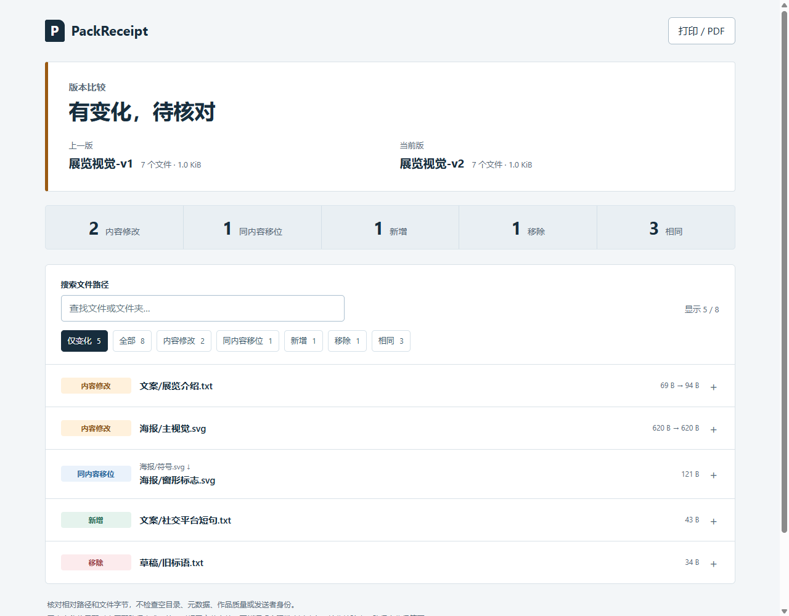

# PackReceipt

给文件夹交付留一份清单，核对两版变化，也核对对方收到的文件。

适合交设计稿、模型导出或素材包时使用。扫描普通文件夹，记录相对路径、字节数和 SHA-256；输出可以搜索、筛选、展开明细和打印的单文件 HTML。全部在本地完成，源文件只读。

[English](README.md) · [下载 v0.1.0](https://github.com/aevumworks/packreceipt/releases/tag/v0.1.0)



## 下载后怎么用

需要 **Python 3.10 或更新版本**，无需第三方 Python 包、账号或服务。在 Releases 下载 `packreceipt-0.1.0.pyz`。下面命令里的 `python` 也可以换成系统提供的 `py` 或 `python3`。

发送方先生成清单，输出必须放在被扫描文件夹以外：

```sh
python packreceipt-0.1.0.pyz scan ./交付文件夹 --out ./交付清单.json
```

把原清单和交付包通过可信渠道交给接收方。接收方重新读取收到的文件：

```sh
python packreceipt-0.1.0.pyz verify ./交付清单.json ./收到的文件夹 --html ./接收核验.html --lang zh
```

双击打开 `接收核验.html`。运行核验需要 Python；只阅读已生成的报告只需浏览器。

## 两次交付之间改了什么

```sh
python packreceipt-0.1.0.pyz scan ./交付-v1 --out ./v1.json
python packreceipt-0.1.0.pyz scan ./交付-v2 --out ./v2.json --label "展览视觉 第二版"
python packreceipt-0.1.0.pyz compare ./v1.json ./v2.json --html ./版本变化.html --json ./版本变化.json --lang zh
```

报告默认显示有变化的文件，可以按状态筛选、搜索前后路径并展开完整哈希。报告自带所需脚本和样式，无外部字体、图片或网络请求。

| 结果 | 含义 |
| --- | --- |
| 内容修改 | 同一相对路径的 SHA-256 或字节数改变 |
| 同内容移位 | 未匹配路径中，唯一一对 SHA-256 与大小一致的旧/新文件；属于配对候选，不能证明实际发生了改名 |
| 新增、移除 | 没有匹配到的路径；重复内容有多种配对时，不猜测对应关系 |
| 相同 | 相对路径、大小与 SHA-256 均相同 |

优先按原路径匹配。接收核验中，即使内容相同，路径变化也会判为不一致。

命令返回码：`0` 表示扫描完成或比较一致；`1` 表示比较完成并发现变化（报告已生成）；`2` 表示输入或读写出错。版本迭代时返回 `1` 可以是正常结果。脚本接入时不要把 `2` 当作通过。

默认拒绝覆盖已有输出；确认需要覆盖时加 `--force`。输出的父目录应先存在，HTML 与 JSON 路径必须不同，也不能替换输入清单。

## 从源码运行与体验示例

在项目根目录，把上述 `python packreceipt-0.1.0.pyz` 换成 `python -m packreceipt` 即可，无需安装到全局。

```sh
python examples/create_demo.py examples/demo
```

输出目录不能事先存在。示例由本项目原创的 SVG 海报、符号、文案和说明组成，属于人工设定问题的测试对象。打开 `examples/demo/` 中的报告：

- `comparison.html`：两版之间，2 项修改、1 项同内容移位、1 项新增、1 项移除、3 项相同。
- `verification-failed.html`：模拟收到旧海报、缺说明、夹带临时文件，分别被识别为修改、移除和新增。
- `verification-passed.html`：示例包修正后，7 个文件全部一致。

Release 的 `.zip` 同时含可直接打开的示例、源代码、测试和 `.pyz`。

## 适用边界

清单核对的是字节和路径，不评价作品质量，不检查专业格式能否正确打开，也不判断版权。它不自动同步、修复或删除文件。

清单和报告包含文件名、相对路径、大小、哈希与文件夹标签。**文件名也可能敏感**，分享前请检查；可用 `--label` 替换默认的根文件夹名。源文件内容与本地绝对路径不嵌入报告。

清单未经数字签名，不能证明发送者身份；请保留可信渠道收到的原清单。扫描时停止写文件；检测到普通并发变化会报错，但扫描不是原子快照，也不应面对恶意并发修改。

第一版遇到符号链接、Windows junction/reparse point、特殊文件或带链接的输入根路径/祖先会明确拒绝，不静默跳过。隐藏文件全部计入，没有默认忽略规则。空目录、权限、时间戳、扩展属性、NTFS 备用数据流不在范围内；压缩包按一个文件哈希，不展开。路径严格区分大小写。

文件逐个完整读取，每次 1 MiB；报告一次渲染全部条目，尚未评估超大目录的性能。JSON 是 PackReceipt 自有版本格式。需要标准化档案打包，可使用成熟的 [bagit-python](https://github.com/LibraryOfCongress/bagit-python)。

## 验证与构建

```sh
python -m unittest discover -s tests -v
python scripts/build_release.py
```

本版实际验收环境：Windows 11 10.0.26200、CPython 3.14、Ego Lite / Chromium 156。20 项标准库测试通过；浏览器验收包含搜索、筛选、空状态、键盘展开、完整哈希、打印动作以及桌面/窄屏布局。已看过截图，窄屏是浏览器模拟，未冒充手机实机验收；macOS/Linux 尚未实际运行。[验证记录](docs/VALIDATION.md)

## 来源与许可

源码、示例图形与文本由 Aevum 为本项目独立创建，采用 [MIT](LICENSE) 许可证。无第三方运行库、字体或图片；BagIt 作为问题定义的参考，没有复制其实现。[版本说明](CHANGELOG.md)
